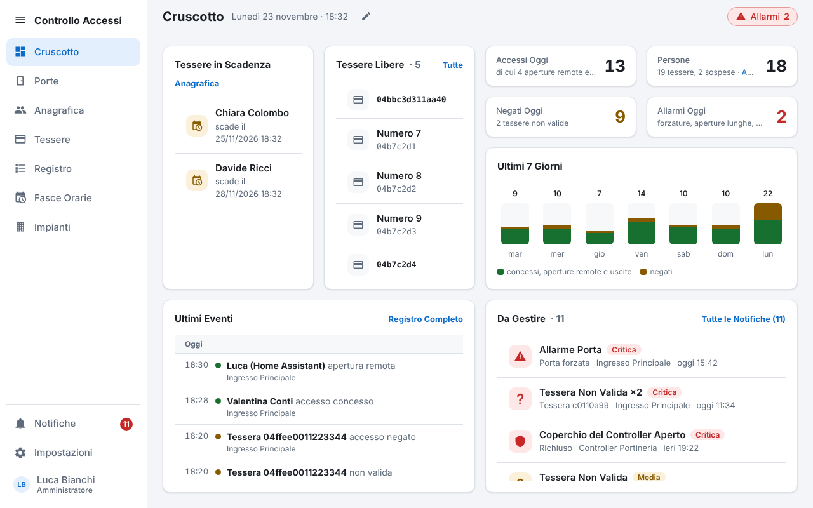
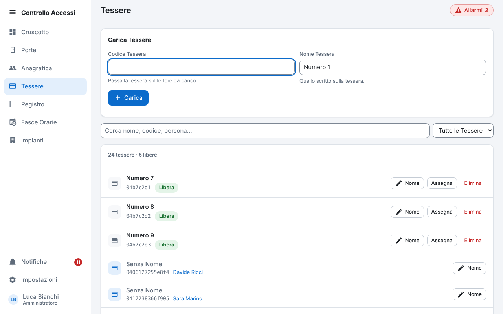

<p align="center"></p>

<p align="center"><a href="#english">English</a> · <a href="#italiano">Italiano</a></p>

## English

Home Assistant add-on to manage people, cards and the access log of an **Axis A1210** door controller.
The interface opens from the Home Assistant sidebar (Ingress). The controller stays the source of truth for door
openings, so doors keep working even when Home Assistant is off.

> **The user interface and the documentation are in Italian only.**



### Features

- People, cards and access types (who, where, when) synchronised with the A1210; time schedules and holidays;
  temporary validity.
- Physical card list: free or assigned cards, loaded with a USB desk reader.
- Access log with camera snapshots and CSV export; CSV import of people.
- Dashboard, notifications for faults and alarms, Home Assistant entities and events (MQTT Discovery).
- Controller set-up from the app: readers ↔ doors, inputs (exit buttons, intercom relay, door contact),
  Hikvision video intercoms through the *Hikvision Doorbell* add-on.
- App users with roles and permissions, optional direct access for staff without Home Assistant.
- Backups with comparison and selective restore; full restore of a reset or replaced controller.

### Requirements

- Home Assistant OS or Supervised (add-ons need the Supervisor), on amd64 or aarch64.
- An Axis A1210 reachable over the network, with an administrator user. Developed and tested with AXIS OS 10.12.
- Optional: an MQTT broker (e.g. the Mosquitto add-on) for the Home Assistant entities; Home Assistant cameras for
  snapshots; the *Hikvision Doorbell* add-on for video intercoms.

### Installation

1. In Home Assistant: *Settings → Add-ons → Add-on Store*, menu at the top right, *Repositories*.
2. Add `https://github.com/lurisin/axis-access-manager`.
3. Install **Axis Access Manager**, enable *Show in sidebar* and start it.
4. Open **Controllo Accessi** in the sidebar. In **Impianti** press **Aggiungi Controller** and enter the address,
   user and password of the A1210 (**Prova Collegamento** checks them). Live events arrive over the controller's
   WebSocket: nothing to configure on the controller.
5. In the controller page, **Porte** tab, press **Gestisci nell'App** on each door to use.

The full guide is in the add-on's *Documentation* tab ([DOCS.md](axis_access_manager/DOCS.md)); release notes are
in the [CHANGELOG](axis_access_manager/CHANGELOG.md). Updates appear in the Add-on Store after *Check for updates*.

### Disclaimer

This is access-control software, provided **as is, without any warranty** (see [LICENSE](LICENSE)). Test it on your
installation before relying on it. It does not replace the safety, fire and emergency-exit rules that apply to your
doors, and the controller must stay configured so that doors work without Home Assistant.

### Security

Please report security problems privately, see [SECURITY.md](SECURITY.md).

### License

[MIT](LICENSE).

---

## Italiano

Add-on di Home Assistant per gestire persone, tessere e registro degli accessi di un controller **Axis A1210**.
L'interfaccia compare nella barra laterale di Home Assistant (Ingress). Il controller resta la fonte di verità per le
aperture, quindi le porte funzionano anche se Home Assistant è spento.



### Cosa fa

- Persone, tessere e tipologie (chi, dove, quando) sincronizzate con l'A1210; fasce orarie e festività; validità
  temporanea.
- Elenco delle tessere fisiche, libere o assegnate, caricate con un lettore da banco USB.
- Registro con le foto delle telecamere ed esportazione CSV; importazione CSV delle persone.
- Cruscotto, notifiche di guasti e allarmi, entità ed eventi in Home Assistant (MQTT Discovery).
- Configurazione del controller dall'app: lettori ↔ porte, ingressi (pulsanti, relè del citofono, contatto porta),
  videocitofoni Hikvision tramite l'add-on *Hikvision Doorbell*.
- Utenti dell'app con ruoli e permessi, accesso diretto facoltativo per il personale senza Home Assistant.
- Backup con confronto e ripristino selettivo; ripristino completo di un controller resettato o sostituito.

### Requisiti

- Home Assistant OS o Supervised (gli add-on richiedono il Supervisor), su amd64 o aarch64.
- Un Axis A1210 raggiungibile in rete, con un utente amministratore. Sviluppato e provato con AXIS OS 10.12.
- Facoltativi: un broker MQTT (per esempio l'add-on Mosquitto) per le entità in Home Assistant; telecamere di Home
  Assistant per le foto; l'add-on *Hikvision Doorbell* per i videocitofoni.

### Installazione

1. In Home Assistant: *Impostazioni → Componenti aggiuntivi → Raccolta componenti aggiuntivi*, menu in alto a destra,
   *Repository*.
2. Aggiungi `https://github.com/lurisin/axis-access-manager`.
3. Installa **Axis Access Manager**, attiva *Mostra nella barra laterale* e avvialo.
4. Apri **Controllo Accessi** nella barra laterale. In **Impianti** premi **Aggiungi Controller** e inserisci
   indirizzo, utente e password dell'A1210 (**Prova Collegamento** li verifica). Gli eventi in diretta arrivano dal
   WebSocket del controller: sul controller non c'è niente da configurare.
5. Nella pagina del controller, scheda **Porte**, premi **Gestisci nell'App** su ogni porta da usare.

La guida completa è nella scheda *Documentazione* dell'add-on ([DOCS.md](axis_access_manager/DOCS.md)), le novità di
ogni versione nel [CHANGELOG](axis_access_manager/CHANGELOG.md). Gli aggiornamenti compaiono nella stessa pagina dopo
*Controlla aggiornamenti*.

### Avvertenza

È un software di controllo accessi, fornito **così com'è, senza alcuna garanzia** (vedi [LICENSE](LICENSE)). Provalo
sul tuo impianto prima di affidarti a lui. Non sostituisce le norme di sicurezza, antincendio e di esodo che valgono
per le tue porte, e il controller deve restare configurato in modo che le porte funzionino senza Home Assistant.

### Sicurezza

I problemi di sicurezza vanno segnalati in privato: vedi [SECURITY.md](SECURITY.md).

### Licenza

[MIT](LICENSE).

### Sviluppo

```
python3 -m venv .venv && . .venv/bin/activate
pip install -r requirements-dev.txt
pytest
ruff check . && ruff format --check .
```

Prove sul controller di banco vero: `python3 tools/banco/prove_a1210.py --help`, istruzioni in `tools/banco/LEGGIMI.md`.

### Struttura del repository

```
repository.yaml              repository di add-on per Home Assistant
LICENSE                      licenza MIT
SECURITY.md                  come segnalare un problema di sicurezza
docs/                        schermate del README
pyproject.toml               impostazioni di pytest e ruff
requirements-dev.txt         dipendenze per i test e ruff
.github/workflows/ci.yaml    test, ruff e controllo dell'add-on a ogni push su main e a ogni pull request
axis_access_manager/         l'add-on
  icon.png, logo.png         icona e logo nella raccolta componenti aggiuntivi
  config.yaml                opzioni, Ingress, servizio MQTT, copia del database prima dei backup di Home Assistant
                             e file esclusi da quei backup
  translations/it.yaml       nomi e descrizioni delle opzioni nella scheda Configurazione
  DOCS.md                    documentazione (scheda Documentazione dell'add-on)
  CHANGELOG.md               novità di ogni versione
  Dockerfile, build.yaml     immagine (Python 3.12 su base Home Assistant)
  requirements.txt           dipendenze Python dell'add-on
  app/
    __main__.py              avvio del server (uvicorn)
    config.py                lettura di /data/options.json e broker MQTT dal Supervisor
    vapix.py                 client VAPIX per l'A1210 (HTTPS + digest)
    events.py                eventi del controller (WebSocket dell'A1210, MQTT facoltativo)
    db.py                    database SQLite in /data (persone, tessere, regole, eventi, audit)
    backup_copy.py           copie coerenti del database (prima dei backup di Home Assistant e degli aggiornamenti)
                             e ripristino dalla copia all'avvio
    service.py               logica: sincronizzazione, persone e tessere, tipologia e validità, eventi, apertura porta
    rules.py                 fasce orarie e festività in iCalendar, validità delle tessere
    rules_service.py         tipologie, profili di accesso Axis, fasce orarie e festività sul controller
    installation.py          impianti: controller e porte con videocitofono e telecamera, configurati nell'app
    programming.py           programmazione del controller (porte, lettori, collegamenti, ingressi) con annullamento
    health.py                stato di ogni controller: raggiungibile, identità, orologio e fuso orario
    notifications.py         notifiche, guasti e allarmi
    backup.py                backup dell'app: dati comuni e configurazione dei controller, confronto, ritenzione, verifica
    restore.py               ripristino selettivo (porte e lettori, tipologie, persone e tessere)
    full_restore.py          ripristino completo di un controller resettato o sostituito
    users.py                 utenti dell'app e permessi
    intercom.py              videocitofono Hikvision tramite l'add-on Hikvision Doorbell
    ha.py                    API di Home Assistant: foto dalle telecamere e chi ha premuto i pulsanti
    ha_mqtt.py               entità ed eventi per Home Assistant via MQTT Discovery
    transfer.py              esportazione e importazione CSV
    main.py                  API e pagina servite tramite Ingress
    static/index.html        interfaccia (HTML e JavaScript senza dipendenze)
tests/                       test (pytest)
tools/banco/                 prove sull'A1210 di banco, fuori dall'add-on (vedi LEGGIMI.md)
```
